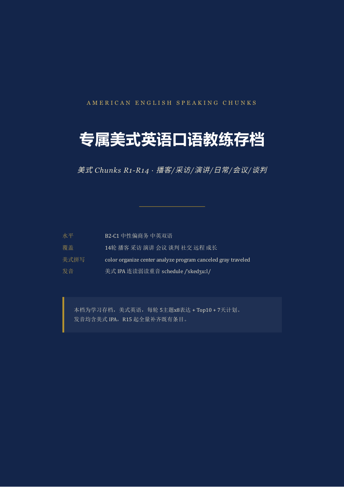
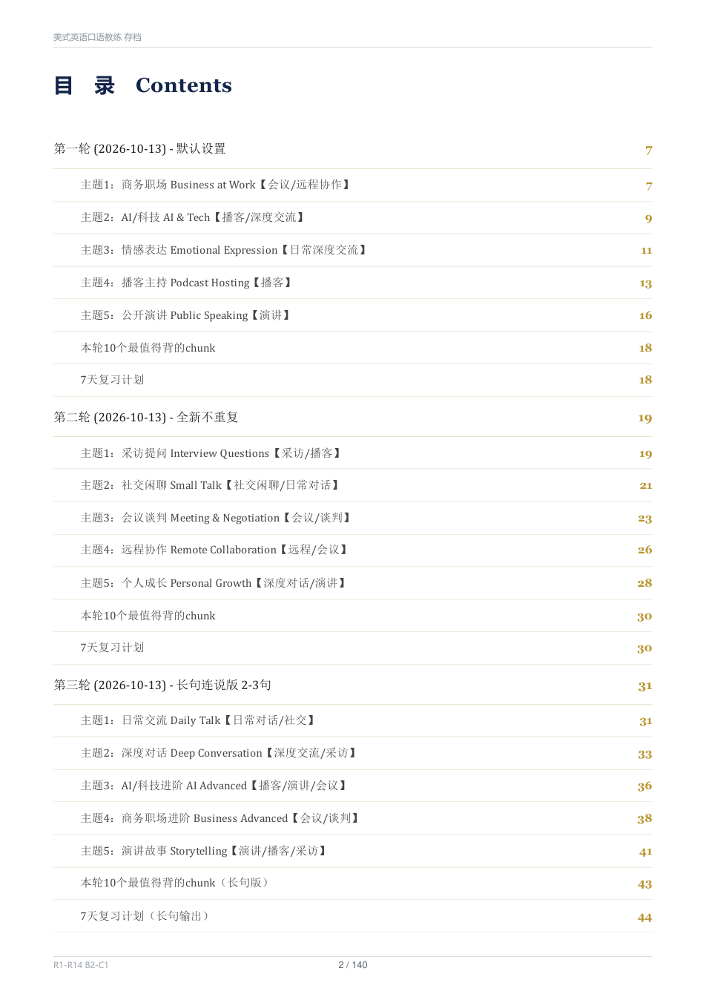
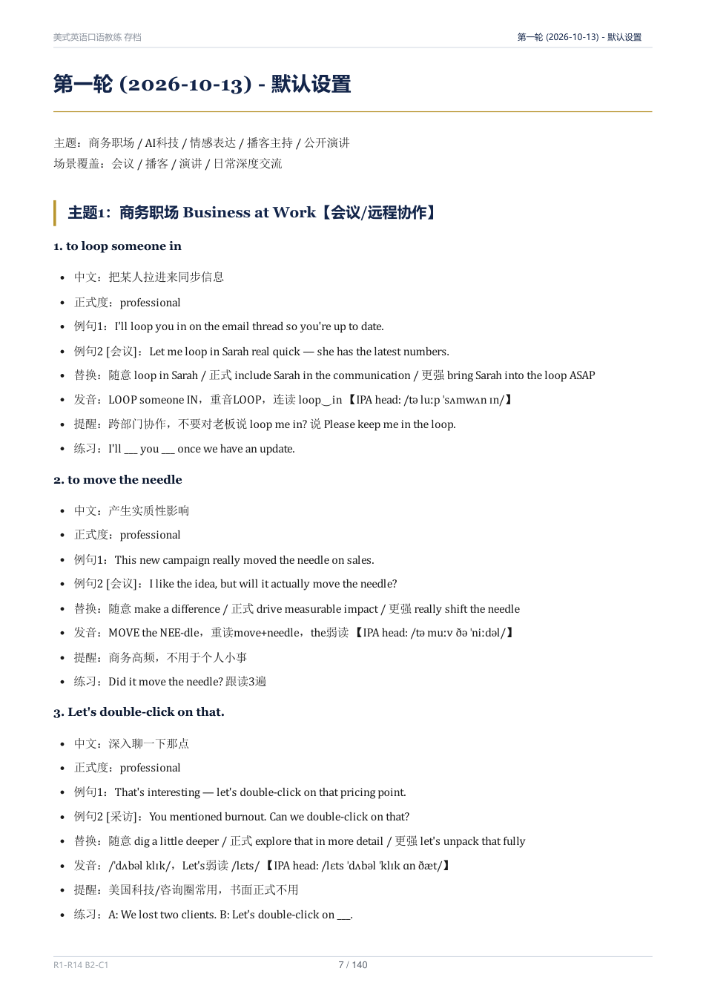
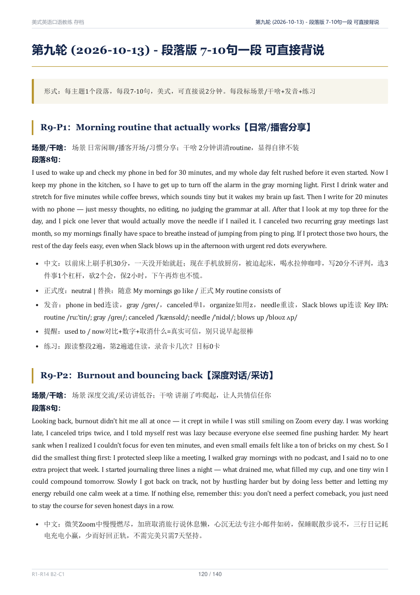
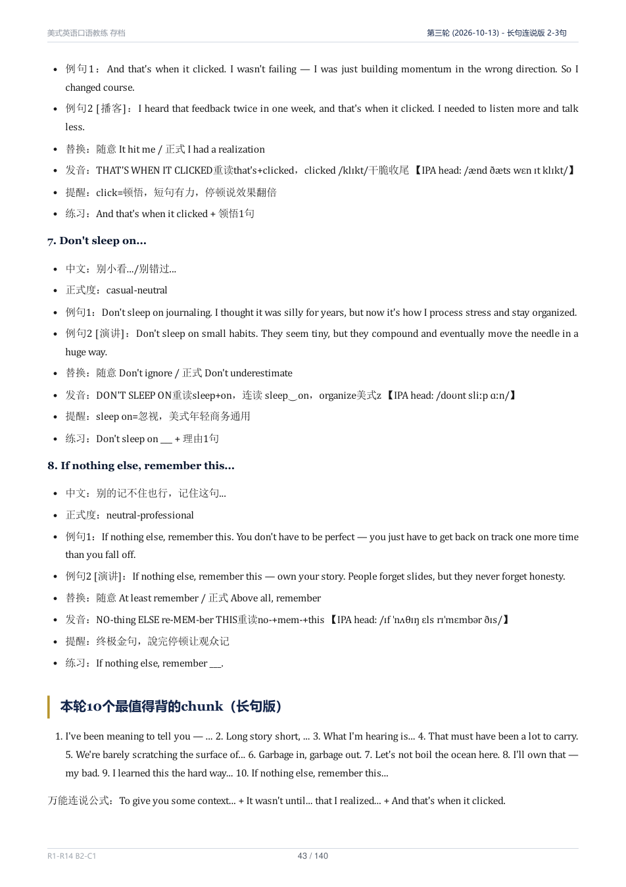

# 专属美式英语口语教练 · American English Speaking Coach

> 背完就能说：播客 / 采访 / 演讲 / 会议 / 谈判 / 社交，全套美式 chunks，条条带美式 IPA。
> B2–C1 · 中性偏商务 · 中英双语 · 14 轮 · 350 条发音全 IPA · MD + 140 页 PDF 开源。



## 你是不是这样

- 单词背了几千，开会还是只会说 `I think...`，说完就卡壳
- 听得懂播客，自己一开口就变成中式英语，` Chinglish` 味藏不住
- 面试被问 `Tell me about yourself`，60 秒讲不清自己
- 想做英文播客 / 英文演讲，串场全靠 `uh... so... next`
- 发音被英美混读毒害：`schedule` 读成 /ˈʃedjuːl/，`traveled` 写成 `travelled`

如果中了 2 条以上，这个仓库就是为你准备的：**不给单词，只给能直接说出口的整块英语**，
每块都告诉你用在哪、怎么发音、怎么练，练完当场就能用。

## 5 个下载理由

- **开口即用**：320 条短句 + 30 个整段，每条都是 2–10 句的完整表达，不是碎单词。
  比如拿起 `Let's unpack that` 就能接话，拿起 `What got you into...?` 就能采访。
- **美式到底**：拼写 organize / center / analyze / program / canceled / gray / traveled，
  发音 schedule /ˈskedʒuːl/、thrive /θraɪv/、known /noʊn/，350 条发音行**全员 IPA**，
  连读弱读重音全标（如 `paint‿you /peɪntʃu/`），一次治好英美混读。
- **场景拉满**：播客串场、采访深挖、演讲收尾、会议控场、薪资谈判、道歉重建、安慰陪伴、
  即兴救场……每条标注**场景 / 能帮你干成什么事**，开会前翻 5 分钟就行。
- **不断片训练**：R5–R6 专门练 keep talking（描述 / 回忆 / 讲解 / 分析 / 续航），
  R9–R14 每段 7–10 句，3 段连说就是一次 6 分钟演讲，卡壳还有 `Where was I? Oh right…` 救场句。
- **学完不忘**：每轮标配 **Top10 必背 + 7 天复习计划**，录音 / 实战 / 默写闭环，
  MD 存档持续追加（R15+），PDF 140 页排版版随时打印。

## 30 秒试读（喜欢就 star）

- `To be on the same page` /tə bi ɑn ðə seɪm peɪdʒ/ —— 开会确认共识，比说 `Do you understand?` 强 10 倍
- `That really hit home for me.` /ðæt ˈriːli hɪt hoʊm fər miː/ —— 深度交流表共鸣，对方立刻觉得被懂
- `Tell me the story behind...` /tɛl mi ðə ˈstɔri bɪˈhaɪnd/ —— 采访神器，比 `Why?` 多挖出 10 倍故事
- `If you take away one thing...` /ɪf ju teɪk əˈweɪ wʌn θɪŋ/ —— 演讲金句前摇，全场自动安静
- `I have to push back a little.` /aɪ hæv tə pʊʃ bæk ə ˈlɪtəl/ —— 礼貌反对，老板听了不炸毛
- `Just ping me on Slack.` /dʒʌst pɪŋ mi ɑn slæk/ —— 远程协作黑话，显得你真在硅谷上过班
- `I'm a work in progress.` /aɪm ə wɜrk ɪn ˈprɑɡrɛs/ —— 示弱拉近距离，深度对话杀手锏
- `Garbage in, garbage out.` /ˈɡɑrbədʒ ɪn ˈɡɑrbədʒ aʊt/ —— 怼烂数据不带脏字，工程师都笑
- `I'll own that — my bad.` /aɪl oʊn ðæt maɪ bæd/ —— 认错三秒信任反升，比解释 10 分钟管用
- `Small wins compound.` /smɔl wɪnz kəmˈpaʊnd/ —— 成长演讲收尾，全场想鼓掌

上面只是 350 条里的 10 条，完整版在 PDF 里按主题排好，照着背就行。

## 效果预览

| 封面 | 自动页码目录（107 个定位点，翻到哪章页眉显示哪章） |
| ---- | -------------------------------------------------- |
|  |  |

| 短句轮：每条 8 项 | 段落轮：7–10 句整段背说 |
| ----------------- | ------------------------ |
|  |  |

| 每轮 Top10 + 7 天计划 |
| --------------------- |
|  |

## 每条长什么样（8 项全是干货）

以 `Let's double-click on that.` 为例：

1. **英文 chunk**：`/lɛts ˈdʌbəl ˈklɪk ɑn ðæt/` —— 整句 IPA，直接跟读
2. **中文意思**：深入聊一下那点 —— 3 秒懂
3. **正式度**：professional —— 开会用不踩雷，casual 场合换 `dig deeper`
4. **美式例句 ×2**：1 日常 + 1 微场景（会议/播客/演讲），2–3 句连说，可整段背
5. **可替换说法**：更随意 / 更正式 / 更强情绪各 1 个，见人说人话
6. **发音提示**：重音、连读（double‿click）、弱读（Let's /lɛts/）、语调，一行讲透
7. **使用提醒**：谁用、哪用、别怎么误用（如书面正式文别用 double-click）
8. **迷你练习**：填空 / 跟读 / 角色扮演，30 秒能做完一个

## 内容一览（R1–R14，先看加粗 3 轮）

| 轮次 | 主题（5×8） | 形式 | 先看 |
| ---- | ----------- | ---- | ---- |
| **R1** | **商务职场 / AI 科技 / 情感表达 / 播客主持 / 公开演讲** | 短句 | 入门必看，40 个最高频 |
| R2 | 采访提问 / 社交闲聊 / 会议谈判 / 远程协作 / 个人成长 | 短句 | 日常+开会 |
| R3 | 日常交流 / 深度对话 / AI 进阶 / 商务进阶 / 演讲故事 | 长句 2–3 句 | 想说长句子从这轮起 |
| R4 | 情感进阶 / 播客进阶 / 采访深挖 / 谈判说服 / 成长进阶 | 长句 | 采访+谈判 |
| **R5–R6** | **Keep Talking：描述/回忆/讲解/分析/续航及 2.0** | 长句 | 卡壳党必修 |
| R7 | 求职面试 / 反馈复盘 / 提请求 / 拒绝说不 / 赞美鼓励 | 长句+场景 | 打工人周报季看 |
| **R8** | **会议控场 / 追问深挖 / 数据讲故事 / 救场尴尬 / 收尾锁定** | 长句+场景 | 开会前 10 分钟翻 |
| R9 | 段落：routine / burnout / 远程会 / 播客翻车 / 成人学英语 | 段落 7–10 句 | 整段背说入门 |
| R10 | 段落：pitch / 自我介绍 / 温柔反馈 / 拒绝边界 / 演讲收尾 | 段落 | 面试周看 |
| R11 | 段落：被批不崩 / 跟进回信 / 给外行讲 AI / 道歉重建 / 未来野心 | 段落 | 职场保命 |
| R12 | 段落：陌生破冰 / 项目收尾 / 延期解释 / AI 去魅 / 周末回血 | 段落 | 社交+复盘 |
| R13 | 段落：谈加薪 / 海外乡愁 / 费曼讲解 / 难搞客户 / 周日复盘 | 段落 | 加薪季看 |
| R14 | 查漏 5 块：幽默自嘲 / 温柔反对 / 安慰陪伴 / 即兴难问 / 澄清确认 | 段落 | 高情商封顶 |

每轮标配 **Top10 必背 + 7 天计划**，R15 起继续追加，永不重复。

## 两个文件怎么选

```text
.
├── American-English-Coaching.md    # 学习版：全文检索、复制、追加都用它（0.3 MB）
├── American-English-Coaching.pdf   # 阅读版：140 页，封面+页码目录+跑动页眉+书签，打印/平板看
└── assets/shots/                   # README 截图
```

- 手机背：用 PDF，140 页 + 书签跳转，比 MD 好翻
- 备课/复制/Anki 制卡：用 MD，`grep` 一下 3 秒定位
- 打印：PDF intl 双语样式，中英文混排 + IPA 显示正常

## 4 周上手法（照抄就行）

- **Week 1 开口**：R1 每天 1 主题跟读录音，目标 0 卡点；周末默写 Top10，抽 5 个即兴 30 秒。
- **Week 2 不断片**：R5–R6 每天 1 主题，3 分钟自播 `kick off → unpack → tie into → where go` 全链条。
- **Week 3 整段输出**：R9–R10 每天背 1 段改成自己的故事，周末连说 3 段 = 6 分钟演讲。
- **Week 4 实战**：拿 R8 去开真会（控场/收尾），拿 R10-P2 去面一次试（60 秒自我介绍），拿 R14-P4 去答一个难问。

## FAQ

- **什么水平适合？** B2–C1 最佳。B1 可从 R1 + R9 入手，先背 Top10；C2 直接拿段落轮改写。
- **英音能用吗？** 不建议。本库按 General American 编写：/ɑ/ 不圆唇、/oʊ/ 双元音、r 处处卷舌，
  英式读法（如 schedule /ˈʃedjuːl/）会被单独标出纠正。
- **IPA 会看不懂？** 每条只标 headword + 关键词，且配 respelling（如 gonna /ˈɡɔnə/），
  跟着录音读 3 天就顺了。实在怕，R9 段落轮先听先跟读。
- **更新吗？** 更。MD 是活文档，R15+ 按同样 8 项格式追加；PDF 每次同步重出，rellaunch 即最新版。
- **能商用吗？** 能。MIT 协议，随便改、随便卖课引用，留个出处就行。

## 路线图

- [x] R1–R14：350 条发音全 IPA，PDF 140 页
- [ ] R15+：面试深挖 2.0、薪资谈判全流程、Q&A 地狱模式
- [ ] 配套 Anki / CSV 速查表（欢迎 PR）

## 排版说明

PDF 由 [md2pdf](https://github.com/jacknnnbauer/md2pdf)（`intl` 双语样式 + Chrome 渲染 +
PyMuPDF 页码目录/页眉书签）生成，107 个定位点 100% 落位，IPA 与中英文混排正常。

## License

MIT，随便用、随便改、随便商用，保留原作者信息即可。
欢迎提 issue：IPA 存疑、场景缺失、想加的主题（已收录：播客 hosting 进阶、远程 async 写作）。
